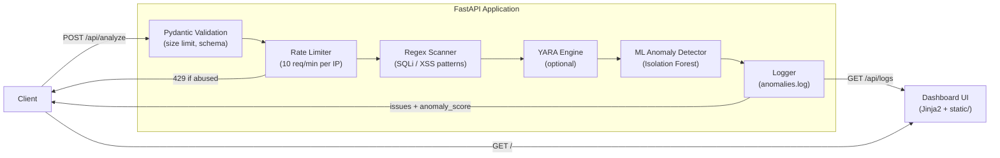
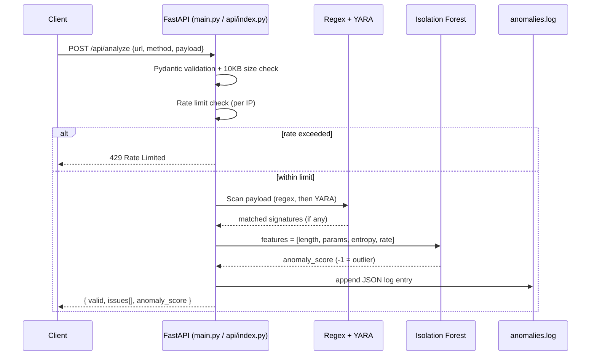

# API Security Analyzer

[](https://www.python.org/downloads/) [](https://fastapi.tiangolo.com/) [](https://scikit-learn.org/) [](LICENSE)

A multi-layer API request security scanner combining regex signatures, YARA rules, and ML-based anomaly detection (Isolation Forest). It validates payloads, flags SQL injection and XSS abuse, rate-limits abusive clients, and logs every decision for review on a live dashboard.

---

## Table of Contents

1. [Overview](#overview)
2. [System Architecture](#system-architecture)
3. [Features](#features)
4. [Detection Mechanisms](#detection-mechanisms)
5. [Evaluation](#evaluation)
6. [API Reference](#api-reference)
7. [Getting Started](#getting-started)
8. [Project Structure](#project-structure)
9. [Technical Considerations](#technical-considerations)
10. [Roadmap](#roadmap)
11. [License](#license)

---

## Overview

The API Security Analyzer is a real-time threat detection service that sits in front of an API endpoint and inspects each request for SQL injection (SQLi), cross-site scripting (XSS), and statistically anomalous traffic patterns. It uses a defense-in-depth approach, running three complementary detectors on every request rather than relying on a single technique:

1. **Regex pattern matching** — fast, deterministic detection of known attack signatures
2. **YARA rule engine** — structured pattern recognition for more complex signatures
3. **ML anomaly detection** — Isolation Forest flags statistical outliers, including attacks with no known signature

---

## System Architecture



### Request Flow



Two entrypoints share this pipeline: `main.py` runs it as a standalone `uvicorn` server with file-based logging and a live dashboard, while `api/index.py` runs the same detection logic as a Vercel serverless function.

---

## Features

- **Input validation** — Pydantic schemas with a 10KB payload size limit
- **Threat detection** — regex + YARA rules for SQLi, XSS, and command injection patterns
- **ML anomaly detection** — Isolation Forest flags zero-day patterns with no known signature
- **Rate limiting** — 10 requests/minute per client IP, in-memory
- **Live dashboard** — real-time log feed and anomaly visualization
- **Structured logging** — JSON-formatted entries in `anomalies.log`

---

## Detection Mechanisms

### 1. Regex Pattern Matching

The first line of defense: compiled regular expressions for well-known attack signatures.

```python
sqli_pat = re.compile(r"union.*select|drop.*table|exec.*sp", re.I)
xss_pat = re.compile(r"<script|javascript:|alert\(", re.I)
```

### 2. YARA Rule Engine

Structured, industry-standard pattern matching, loaded only when the `yara-python` package is available:

```yara
rule SQLi {
    strings:
        $sqli = /union.*select/i
    condition:
        $sqli
}

rule XSS {
    strings:
        $xss = /<script|javascript:|alert\(/i
    condition:
        $xss
}
```

### 3. ML Anomaly Detection

Four features are extracted from each request and scored by an Isolation Forest model:

| Feature | Description |
|---------|--------------|
| `payload_length` | Character count of the request payload |
| `num_parameters` | Number of JSON fields in the payload |
| `entropy` | Shannon entropy of the payload content |
| `request_rate` | Recent requests per minute from the same IP |

**Why Isolation Forest?**
- Linear-time average case complexity
- No distance calculations required
- Handles high-dimensional feature spaces well
- Produces a continuous anomaly score for severity ranking, not just a binary flag

---

## Evaluation

### Test Dataset

The system was evaluated against a dataset of 40 API requests:

| Category | Count | Description |
|----------|-------|--------------|
| Legitimate requests | 10 | Normal API traffic patterns |
| SQLi attacks | 15 | UNION-based, stacked queries, boolean-based |
| XSS attacks | 15 | Reflected, stored, DOM-based vectors |

### Detection Performance by Mechanism

| Mechanism | True Positives | False Positives | Precision | Recall | F1 |
|-----------|----------------|------------------|-----------|--------|-----|
| Regex | 20 | 0 | 100.0% | 66.7% | 80.0% |
| YARA | 18 | 0 | 100.0% | 60.0% | 75.0% |
| ML (Isolation Forest) | 30 | 10 | 75.0% | 100.0% | 85.7% |
| **Combined (ensemble)** | **30** | **10** | **75.0%** | **100.0%** | **85.7%** |

### Latency Benchmarks

| Component | P50 | P95 | P99 |
|-----------|-----|-----|-----|
| Regex | 0.00ms | 0.01ms | 0.01ms |
| YARA | 0.00ms | 0.02ms | 0.02ms |
| ML inference | 4.38ms | 4.53ms | 4.71ms |
| **Combined** | **4.38ms** | **4.83ms** | **4.92ms** |

*Test environment: Python 3.11, scikit-learn 1.5+*

### Key Findings

- **Ensemble advantage** — the combined system reaches 100% recall by layering all three detectors
- **Zero false positives from rules** — regex and YARA alone never flag legitimate traffic
- **ML trade-off** — higher false-positive rate, but catches attacks the rule-based layers miss; best used as a secondary signal
- **Low latency** — sub-5ms P99, suitable in front of a production API

---

## API Reference

### `POST /api/analyze`

Analyzes a single API request for security threats.

**Request**
```json
{
  "url": "/api/users",
  "method": "POST",
  "payload": {"username": "test", "data": "<script>alert(1)</script>"}
}
```

**Response**
```json
{
  "valid": false,
  "issues": ["XSS detected", "ML Anomaly (score: -0.15)"],
  "anomaly_score": -0.15
}
```

### `GET /api/logs`

Returns the most recent security events.

### `GET /`

Serves the dashboard interface.

---

## Getting Started

### Local Development

```bash
pip install -r requirements.txt
python main.py
```

The server runs at `http://localhost:8000`.

### Run Evaluation

```bash
python evaluate.py
```

### Deploy to Vercel

```bash
npm i -g vercel
vercel --prod
```

See [DEPLOY.md](DEPLOY.md) for the full deployment guide.

---

## Project Structure

```
api-security-analyser-dashboard/
├── main.py              # Local FastAPI server (uvicorn)
├── api/
│   └── index.py          # Vercel serverless entrypoint
├── static/
│   ├── style.css         # Dashboard styles
│   └── script.js         # Frontend JavaScript
├── templates/
│   └── index.html        # Dashboard HTML (Jinja2)
├── evaluate.py           # Detection performance evaluation script
├── requirements.txt      # Python dependencies
├── vercel.json           # Vercel deployment config
├── DEPLOY.md             # Vercel deployment guide
└── README.md             # This file
```

`anomalies.log` is generated at runtime and is gitignored, not tracked in the repo.

### Requirements

```
fastapi>=0.100.0
uvicorn>=0.22.0
scikit-learn>=1.3.0
numpy>=1.24.0
jinja2>=3.1.0
pydantic>=2.0.0
yara-python>=4.3.0
python-multipart>=0.0.6
```

---

## Technical Considerations

- **YARA availability** — optional; the service degrades gracefully if `yara-python` isn't installed
- **ML model** — currently trained on synthetic data; retrain on real traffic before relying on it in production
- **Rate limiting** — in-memory, per-process; use Redis for multi-instance or serverless deployments where state must be shared

---

## Roadmap

- Model retraining pipeline — continuous learning from verified attacks
- Redis-backed rate limiting — shared state across instances
- Additional attack vectors — command injection, LDAP injection, XXE
- SIEM integration — webhook alerts to Splunk, Elastic, QRadar

---

## License

MIT — see [LICENSE](LICENSE) for details.

---

## Author

**Kasmya Bhatia**
